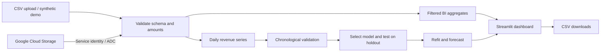

# Sales Forecasting and Business Intelligence using Cloud Analytics

**SalesScope** is a runnable master's project foundation: an interactive Python BI dashboard, validated sales ingestion, three forecasting algorithms, chronological model evaluation, Google Cloud Storage integration and cloud container packaging. Demo data are synthetic. Academic acceptance depends on your university rubric, original analysis and real-data evaluation; this repository does not claim completed research findings.

GitHub repository: [RajatJangra2653/sales-forecasting-business-intelligence-cloud-analytics](https://github.com/RajatJangra2653/sales-forecasting-business-intelligence-cloud-analytics).

The [Word case study](docs/SalesScope_Case_Study.docx) explains the business scenario, system architecture, models, chronological evaluation, saved synthetic results, BI decisions, proposed cloud deployment and limitations, with charts and references.

## Features
- BI: revenue, gross profit, margin, units, region/category comparisons and calendar heatmap.
- Input: reproducible demo, CSV upload, or a private GCS object through server credentials.
- Forecasts: weekly seasonal naive, regularized calendar/lag regression and gradient boosting.
- Evaluation: two expanding validation folds for model selection and a separate final holdout.
- Planning: empirical error bands, scenario adjustment and downloadable forecasts/metrics.
- Delivery: Dockerfile, automated tests, GitHub Actions and documented hosting paths.

## Architecture

Cloud Run hosts the Python container; GCS is the optional durable raw-data layer. Analytics run in the app process. This is a small-data cloud analytics application, not a distributed warehouse or an implemented BigQuery pipeline. Uploads and forecasts are held in memory and are not persisted by the app.

## Run locally
Clone the repository first when setting up a new machine:

```bash
git clone https://github.com/RajatJangra2653/sales-forecasting-business-intelligence-cloud-analytics.git
cd sales-forecasting-business-intelligence-cloud-analytics
```

Use Python 3.11 (recommended). Run commands from this directory:
```bash
python3 -m venv .venv
source .venv/bin/activate
# Windows PowerShell: .venv\Scripts\Activate.ps1
python -m pip install -r requirements.txt
python -m streamlit run app.py
```
Open http://localhost:8501. Demo data load automatically; no credentials or dataset download are needed. Open **Forecast laboratory**, enable training and wait for model evaluation. Change filters to compare segments. The first run may take several seconds.

## CSV contract
Required columns (extra columns are ignored):

| Column | Meaning | Example |
|---|---|---|
| date | Parseable date, normalized to UTC day | 2025-01-01 |
| region | Nonblank sales region | North |
| category | Nonblank product category | Home |
| units | Finite non-negative numeric quantity | 12 |
| revenue | Finite non-negative amount in one consistent currency | 1200 |
| cost | Finite non-negative cost of goods sold, same currency | 800 |

```csv
date,region,category,units,revenue,cost
2025-01-01,North,Home,12,1200,800
2025-01-02,North,Home,15,1500,1000
```
This snippet illustrates the schema; forecasting needs at least `90 + 3 × horizon` consecutive daily observations. Repeated dates/rows are summed, not deduplicated. Missing dates cause a validation message unless explicitly treated as zero-sales days. The upload limit is 20 MB. Gross profit is revenue minus cost; margin is gross profit divided by revenue. Cost excludes operating expenses unless your source explicitly includes them.

Generate a reusable sample:
```bash
python -c "from analytics.data import demo_data; demo_data().to_csv('sample_sales.csv', index=False)"
```

## Hosting option 1: Streamlit Community Cloud
This is the simplest demonstration path; use demo or non-sensitive data.
1. Put **the contents of this directory** at the root of a GitHub repository, including `app.py`, `analytics/`, `requirements.txt` and `.streamlit/`.
2. Push the repository to GitHub and sign in at https://share.streamlit.io.
3. Choose **Create app**, select the repository and branch, and set the main file to `app.py`.
4. Under advanced settings choose Python 3.11, then deploy.
5. Verify that demo charts render and the forecast laboratory runs. Review deployment logs if dependencies fail.

If keeping this as a subdirectory of another repository, set the entrypoint to `sales_cloud/app.py` and retain its adjacent requirements file. Do not commit cloud credentials. Community Cloud can sleep when inactive; it is appropriate for a student demonstration, not an always-on production SLA. Official guidance: [deployment](https://docs.streamlit.io/deploy/streamlit-community-cloud/deploy-your-app/deploy), [dependencies](https://docs.streamlit.io/deploy/streamlit-community-cloud/deploy-your-app/app-dependencies).

## Hosting option 2: Docker
Install Docker, then run:
```bash
docker build -t salesscope .
docker run --rm -p 8080:8080 salesscope
```
Open http://localhost:8080. The container listens on the `PORT` environment variable (default 8080).

## Hosting option 3: Google Cloud Run + private Cloud Storage
Prerequisites: a Google Cloud project with billing, the gcloud CLI, permissions to enable APIs/build/deploy services, and appropriate IAM administration permissions. Resource usage can incur charges. Replace the example values below. Run from this project directory.

```bash
gcloud auth login
gcloud config set project YOUR_PROJECT_ID
gcloud services enable run.googleapis.com cloudbuild.googleapis.com artifactregistry.googleapis.com storage.googleapis.com
gcloud iam service-accounts create salesscope-runtime --display-name="SalesScope runtime"
gcloud storage buckets create gs://YOUR_GLOBALLY_UNIQUE_BUCKET --location=asia-south1 --uniform-bucket-level-access
python -c "from analytics.data import demo_data; demo_data().to_csv('sample_sales.csv', index=False)"
gcloud storage cp sample_sales.csv gs://YOUR_GLOBALLY_UNIQUE_BUCKET/sales.csv
gcloud storage buckets add-iam-policy-binding gs://YOUR_GLOBALLY_UNIQUE_BUCKET --member="serviceAccount:salesscope-runtime@YOUR_PROJECT_ID.iam.gserviceaccount.com" --role="roles/storage.objectViewer"
gcloud run deploy salesscope --source . --region asia-south1 --port 8080 --memory 1Gi --cpu 1 --concurrency 4 --max-instances 2 --timeout 300 --service-account salesscope-runtime@YOUR_PROJECT_ID.iam.gserviceaccount.com --set-env-vars GCS_BUCKET=YOUR_GLOBALLY_UNIQUE_BUCKET,GCS_OBJECT=sales.csv --no-allow-unauthenticated
```
Source deployment builds the Dockerfile. Required deployment roles are Cloud Run Source Developer and Service Usage Consumer on the project, plus Service Account User on the runtime identity; the build identity needs Cloud Run Builder. See the official [source deployment IAM guide](https://docs.cloud.google.com/run/docs/deploying-source-code) and [build identity guide](https://docs.cloud.google.com/run/docs/configuring/services/build-service-account). Your deployer/build identity may need additional organization-specific source-build and service-account permissions; inspect gcloud's error guidance rather than granting broad owner permissions. A previously public service can retain IAM grants: verify its invoker policy explicitly.

For a private local demonstration tunnel:
```bash
gcloud run services proxy salesscope --region asia-south1 --port 8080
```
Open http://localhost:8080 with an authorized account. In the sidebar select **Google Cloud Storage**, then **Load configured cloud dataset**. The runtime service account reads only objects in the bucket granted above. No service-account key file is necessary.

For a public demonstration using only synthetic/non-sensitive data, explicitly grant public invocation:
```bash
gcloud run services add-iam-policy-binding salesscope --region asia-south1 --member=allUsers --role=roles/run.invoker
```
Every visitor to a public app can access its configured cloud dataset; there is no app-level authorization. Use an authenticated access layer before exposing private business data. Cloud Run instances have ephemeral storage; no uploaded file is stored durably. WebSocket sessions can disconnect at the service timeout; reloading recomputes session state. Monitor logs, memory, request duration and billing. See [container port configuration](https://docs.cloud.google.com/run/docs/configuring/services/containers).

For local GCS testing:
```bash
gcloud auth application-default login
export GCS_BUCKET=YOUR_GLOBALLY_UNIQUE_BUCKET
export GCS_OBJECT=sales.csv
python -m streamlit run app.py
```
The local account also needs object-read access to this bucket. On Windows use `$env:GCS_BUCKET="..."` and `$env:GCS_OBJECT="..."`.

## Reproduce an experiment without the UI
```bash
python experiment.py --horizon 28 --output results
# Real dataset:
python experiment.py --csv your_sales.csv --horizon 28 --output real_results
```
The output directory contains model comparisons, per-fold metrics, holdout predictions, future forecasts and a JSON summary identifying the data source. Keep these artifacts with the dataset version and environment details for your dissertation.

## Tests and project layout
```bash
python -m unittest discover -s tests -v
```
Tests cover invalid input, missing dates, repeatable demo generation, seasonal recursion, forecast bounds, zero/short series and final-holdout isolation from selection. CI runs the suite with Python 3.11.

```text
app.py                    Interactive dashboard
experiment.py             Reproducible CLI experiment
analytics/data.py         Validation, demo data and GCS ingestion
analytics/forecast.py     Models, metrics and temporal evaluation
tests/test_pipeline.py    Analytics regression tests
docs/METHODOLOGY.md       Research design and dissertation guide
Dockerfile                Cloud-ready Python container
.github/workflows/        Continuous integration
```

## Research and limitations
Read [METHODOLOGY.md](docs/METHODOLOGY.md) for fold definitions, features, equations, assumptions and dissertation structure. Revenue forecasts are conditional on historical patterns. Error bands are exploratory and have no guaranteed coverage. Scenario adjustments are assumptions, not causal effects. Synthetic-data scores must not be reported as real-world accuracy. Scheduled retraining, database persistence, built-in authentication and distributed processing are future extensions.

## AI assistant context and project history

The project includes durable context for future AI sessions:

| File | Purpose |
| --- | --- |
| [AGENTS.md](AGENTS.md) | Canonical startup and working instructions |
| [PROJECT_CONTEXT.md](docs/PROJECT_CONTEXT.md) | Current architecture, decisions, commands, verification and open work |
| [PROJECT_HISTORY.md](docs/PROJECT_HISTORY.md) | Available user requests and chronological work record |
| [CLAUDE.md](CLAUDE.md) | Claude instruction entry point importing AGENTS.md |
| [GEMINI.md](GEMINI.md) | Gemini instruction entry point importing AGENTS.md |
| [Copilot instructions](.github/copilot-instructions.md) | GitHub Copilot entry point linking to the same records |

Entry files exist at both the original outer workspace and this application root so the project context survives moving or extracting `sales_cloud/`. Keep them in version control alongside the source. Launch tools from one of these roots and check that project instructions are enabled in the tool's settings.

For an AI tool that does not discover them automatically, use:

> Read AGENTS.md, docs/PROJECT_CONTEXT.md and docs/PROJECT_HISTORY.md before doing any work. Continue the existing project rather than recreating it. After meaningful work, update the current context and append the request, changes, checks and remaining work to the history.

If starting from the outer workspace, read its `AGENTS.md` first; the documentation paths above are then under `sales_cloud/`.

The history preserves the available requests verbatim and summarizes completed work; it is not a complete raw chat export. AI tools do not gain access to unsaved or private conversations through these files. Future history maintenance depends on the tool reading and following the instructions; verify updates after important sessions. Adding these files to an already-running session may require explicitly asking it to read them or starting a new session.

Official references for the included entry formats: [Codex AGENTS.md](https://learn.chatgpt.com/docs/agent-configuration/agents-md), [Claude project memory](https://code.claude.com/docs/en/memory), [Gemini context files](https://geminicli.com/docs/cli/gemini-md/), and [Copilot instruction support](https://docs.github.com/en/copilot/reference/custom-instructions-support).

## Troubleshooting and cleanup
- Missing modules: activate the environment and reinstall `requirements.txt`.
- Not enough history: widen the selected dates or shorten the horizon.
- Missing calendar days: investigate missing records before enabling zero fill.
- GCS permission denied: verify bucket name, runtime identity and object-viewer grant.
- Container startup error: confirm it listens on `0.0.0.0:$PORT` and inspect service logs.
- Cloud Run memory pressure: reduce dataset size/concurrency or increase memory.
- To stop hosting charges, delete the Cloud Run service with `gcloud run services delete salesscope --region asia-south1`. Separately remove unneeded storage objects/buckets, Artifact Registry images and build artifacts through the cloud console after reviewing their contents. Deleting the service alone does not remove these resources.
